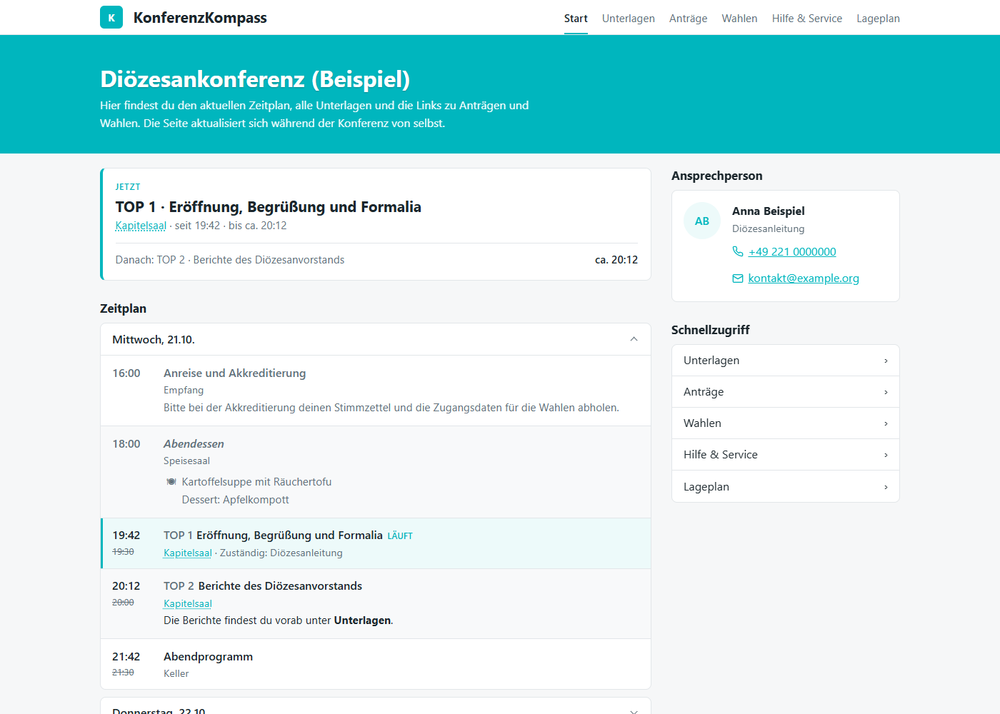
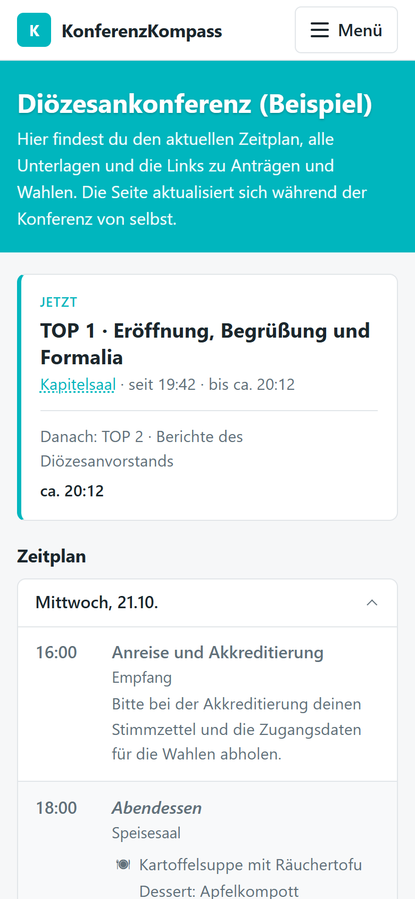
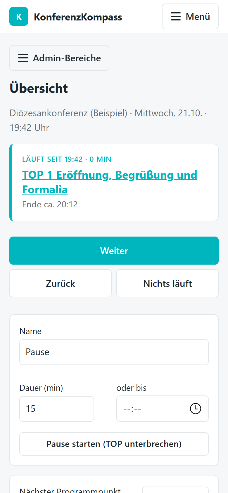
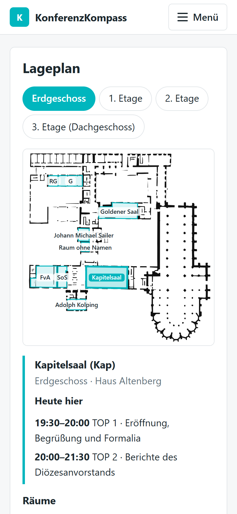

<div align="center">

# KonferenzKompass

**Der Live-Zeitplan für Konferenzen und Mitgliederversammlungen.**<br>
Alle sehen auf dem Handy, was gerade läuft, wo es stattfindet und was als Nächstes kommt.

[](LICENSE)
[](https://bun.sh)
[](compose.yaml)



</div>

KonferenzKompass ist eine leichte, selbst gehostete Webseite – entstanden für die Diözesankonferenzen von Jugendverbänden. Verschiebt sich etwas im Ablauf, sehen es alle sofort. Die Seite ist bewusst schlank, damit sie auch bei schwachem WLAN funktioniert.

## Funktionen

- **Live-Zeitplan:** zeigt den aktuellen TOP, Verspätungen und die voraussichtlichen neuen Zeiten (die geplanten bleiben sichtbar). Gesteuert wird er vom Handy aus über die Live-Steuerung im Admin-Bereich; die Startseite aktualisiert sich selbst, die Live-Steuerung ebenso – so sehen mehrere Personen an mehreren Handys denselben Stand.
- **Änderungsprotokoll:** wer wann einen Eintrag oder den Live-Stand geändert hat, kurz auf der Übersicht und vollständig je Veranstaltung.
- **Zeitplanung:** feste und fließende Einträge, Unterpunkte (z. B. parallele Arbeitskreise), Essen bei Pausen, CSV-Import und -Export.
- **Lageplan:** Grundrisse je Etage, eingezeichnete Räume, Raumsuche und Raumbelegung. Räume im Zeitplan verlinken direkt auf den Plan. Der Plan der Jugendbildungsstätte **Haus Altenberg** ist schon enthalten – wer dort tagt, muss nichts selbst einzeichnen.
- **Seiten:** Unterlagen, Anträge, Wahlen (Links z. B. zu Nextcloud, Antragsgrün, OpenSlides), Hilfe & Service, Impressum und Datenschutz – alle umbenenn- und ausblendbar.
- **Startseite:** Einführungstext, FAQ und Ansprechperson mit Foto.
- **Eigenes Erscheinungsbild:** Titel, Logo, Favicon, Farben und Titelbild.
- **Darkmode:** richtet sich nach der Einstellung des Geräts und lässt sich unten auf jeder Seite auf Hell, Automatisch oder Dunkel stellen. Der Hintergrund ist echtes Schwarz (spart Akku auf OLED-Displays). Die Farben werden dafür automatisch aufgehellt, unter *Einstellungen* lassen sich auch eigene festlegen.
- **Admin-Bereich:** mehrere Konten mit einzeln vergebbaren Rechten (z. B. nur Zeitplan).
- **Veranstaltungen** archivieren, kopieren und löschen. Archivierte sind nicht mehr öffentlich.
- **Sicherung:** Erscheinungsbild, Seiten, Benutzer, Orte und Veranstaltungen einzeln oder alle zusammen als eine Datei exportieren und wieder importieren – als Backup oder um Vorlagen in eine andere Installation zu übernehmen.

Die Oberfläche ist auf Deutsch.

<table>
  <tr>
    <td align="center"><br><sub>Für Teilnehmende: was gerade läuft</sub></td>
    <td align="center"><br><sub>Live-Steuerung: ein Tipp auf „Weiter“</sub></td>
    <td align="center"><br><sub>Lageplan: der Raum zum TOP</sub></td>
  </tr>
</table>

## Installation

Voraussetzung: Docker oder [Bun](https://bun.sh) ≥ 1.2.

```sh
# mit Docker
ADMIN_USER=admin ADMIN_PASSWORD='ein-langes-passwort' docker compose up -d --build

# oder direkt mit Bun
bun install --production
ADMIN_USER=admin ADMIN_PASSWORD='ein-langes-passwort' bun run start
```

Die Seite läuft auf Port 3000, der Admin-Bereich unter `/admin`.

Beim ersten Start wird aus `ADMIN_USER` und `ADMIN_PASSWORD` (mind. 12 Zeichen) ein Admin mit allen Rechten angelegt; danach werden die Variablen ignoriert. Außerdem entsteht eine Beispielveranstaltung mit Zeitplan und dem Lageplan von Haus Altenberg zum Ausprobieren. Sie lässt sich unter *Admin → Veranstaltungen* löschen oder als Vorlage kopieren. Impressum und Datenschutz enthalten nur Platzhalter und müssen ausgefüllt werden.

| Variable | Bedeutung |
|---|---|
| `ADMIN_USER`, `ADMIN_PASSWORD` | erster Admin (nur beim ersten Start) |
| `PORT` | Port, Standard `3000` |
| `TRUST_PROXY` | `1` hinter einem Reverse-Proxy, damit die Sperre nach Fehlversuchen pro Besucher-IP greift. Ohne Proxy weglassen. |
| `SERVICE_WORKER` | `off` schaltet die Offline-Funktion ab: Geräte löschen beim nächsten Besuch die gespeicherten Seiten und den Service Worker. Notbremse, falls eine fehlerhafte Version ausgeliefert wurde; danach Variable wieder entfernen. |

Die App spricht nur HTTP; für HTTPS gehört ein Reverse-Proxy davor (z. B. Caddy oder nginx). Die Docker-Variante ist deshalb nur über `127.0.0.1:3000` erreichbar.

Der Container läuft ohne Root-Rechte als Benutzer `bun` (UID 1000); der Ordner `data/` muss ihm gehören. `/health` antwortet mit `ok`, solange App und Datenbank laufen – Docker nutzt das für seinen Health-Check, Reverse-Proxy oder Monitoring können es ebenso.

**Daten und Backup:** Datenbank und hochgeladene Dateien liegen im Ordner `data/`. Backup = diesen Ordner kopieren, oder im Admin-Bereich unter *Sicherung* alles als eine Datei herunterladen (siehe unten).

**Update:** `git pull`, dann `docker compose up -d --build` bzw. `bun install --production` und Neustart.

## Gut zu wissen

- **Feste und fließende Einträge:** Einträge mit fester Uhrzeit (z. B. Mittagessen) behalten ihren Beginn, alle anderen schließen direkt an den vorherigen an. Überschneidungen zeigt der Zeitplan rot an.
- **Als App installieren:** Die Startseite bietet es an, wo der Browser es kann: in Chrome und Edge (auch auf Android) mit Knopf, auf dem iPhone mit Hinweis auf *Teilen → Zum Home-Bildschirm*. Firefox kann Seiten am Rechner nicht als App installieren, die Offline-Funktion gibt es dort trotzdem (nicht in privaten Fenstern). Das Symbol kommt aus *Einstellungen → App-Icon* (sonst das Favicon, ohne Favicon der erste Buchstabe des Seitentitels). Installieren geht nur über HTTPS (oder `localhost`).
- **Ohne Netz:** Schon beim ersten Besuch speichert der Browser alle öffentlichen Seiten samt Bildern und Grundrissen. Ohne Netz – oder wenn das WLAN nach 3 Sekunden noch nicht antwortet – erscheint die gespeicherte Seite mit „Offline – Stand hh:mm“ unter dem Kopf; die „Jetzt“-Karte zeigt ihr Alter statt eines Timers. Der Admin-Bereich wird nie gespeichert. Safari löscht den Speicher nach etwa 7 Tagen ohne Nutzung.
- **Tageswechsel:** Ein Veranstaltungstag dauert bis 04:00 Uhr, damit z. B. die Party über Mitternacht weiterläuft.
- **CSV-Import:** Am einfachsten erst exportieren und die Datei als Vorlage nutzen (Excel mit `;` funktioniert). Vor dem Import zeigt eine Vorschau alle Fehler. Der Import ersetzt den ganzen Zeitplan.
- **Lageplan weitergeben:** Ein Ort lässt sich samt Grundrissen als JSON exportieren und in einer anderen Installation importieren.
- **Sicherung:** Unter *Admin → Sicherung* wählst du aus, was in die Datei kommt (JSON, Bilder eingebettet). Beim Import zeigt eine Vorschau jeden Teil mit der geplanten Aktion: anlegen, ersetzen oder überspringen. Veranstaltungen und Orte werden über ihren Namen erkannt, Räume im Zeitplan bleiben zugeordnet. Der Live-Stand und Anmeldungen gehören nicht dazu; importierte Veranstaltungen kommen als Entwurf an. Jeder Teil braucht das passende Recht (Benutzer nur mit dem Recht *Benutzer*). Mit Benutzern enthält die Datei die Passwort-Hashes – sie gehört dann nicht in fremde Hände. Das eigene Konto wird beim Import nie überschrieben.

## Entwicklung

```sh
bun install
bun run dev    # Neustart bei Änderungen
bun test
bun run e2e    # Offline-App im Browser (Chromium und Firefox); einmalig vorher: npx playwright install chromium firefox
```

Technik: [Bun](https://bun.sh), [Hono](https://hono.dev) mit serverseitigem JSX, SQLite, wenig JavaScript im Browser.

Ideen für spätere Versionen stehen in der [ROADMAP](ROADMAP.md).

## Lizenz

[GNU AGPL-3.0](LICENSE). Wer eine veränderte Version öffentlich betreibt, muss den geänderten Quellcode ebenfalls zugänglich machen.
